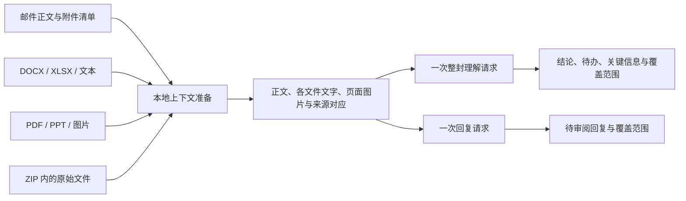

# 整封邮件 AI 上下文

Boxmail 0.1.9（build 48）将单封理解与 AI 回复的资料单位统一为「邮件正文与全部附件」。对外继续使用 `summary`、`reply` 任务和既有结果格式；单文件深入分析、翻译、会话 AI 及分类保持各自职责。

## 处理链路

`mail-ai-context.js` 负责本地准备和覆盖记录，复用现有附件提取、PDF/PPT 页面渲染及 ZIP 隔离解析。`agent.js` 负责任务与结果保存，`responses.js` 负责模型协议和整封理解规则。模型只接收本次原始资料，不把此前逐附件生成的分析当作事实输入；准备过程不调用模型，也不覆盖独立附件分析。

同一次请求包含正文、所有可读附件以及 ZIP 内可读文件。文本不再截取前 16,000 字符。图片与页面保持文件内顺序，`imageIndices` 明确指出它们在完整图片输入中的位置，避免同名文件或不同 PDF 的页面混淆。模型需交叉核对正文与附件中的金额、日期、版本及要求；冲突必须说明依据文件和待确认事项。

## 范围与限制

- 使用现有解析边界：文字提取 200,000 字符，PDF/PPT 页面、ZIP 文件数及解压范围沿用现有实现。文字截断标记让结果说明哪些资料只纳入部分内容。
- 支持图片的模型接收 PDF/PPT 页面及图片原件；仅支持文字的模型使用可提取文字，并明确提示未读取页面图表。无法使用的图片、加密或不支持的文件仍列入覆盖清单，附未纳入原因。
- 已配置的模型上下文窗口由现有协议层检查。超出窗口时请求失败并保留旧结果，不静默删掉后面的附件，也不自动启动逐文件摘要或额外模型请求。未显式配置窗口时使用协议层默认容量，参数见 [后端接口](../Backend/README.md#ai-请求与任务恢复)。
- 部分文件无法读取时，可以基于可读正文及附件生成结果；结果和回复预览必须展示部分覆盖。用户可展开清单核对具体文件、ZIP 子项及原因。
- 翻译仍只翻译邮件正文；会话 AI 仍沿用现有往来上下文及覆盖限制。会话任务不自动提交所有历史附件。

## 客户端与兼容

总结卡和回复结果增加可选 `context` 覆盖元数据，不改变邮件、待办和草稿的既有含义，也不迁移或删除旧结果。旧结果仍可读；有附件但没有覆盖记录时，界面提示重新理解。邮件工具栏及附件区提供「整封理解」，独立附件分析保留在文件预览和附件菜单中。

单封理解与回复复用现有后台 job、流式输出与轮询机制。本地准备多个文档不会占用原先同步 HTTP 请求的等待期限；模型仍使用用户配置的请求超时。采用回复依旧只创建可编辑草稿，发送继续要求用户确认。

## 验证与维护

本地回归核对正文、多附件、ZIP 子项及扫描 PDF 是否出现在同一次模型请求中，检查页面顺序、三个模型协议、文字模型的缺失提示、旧结果兼容、失败保留与上传文件清理。原生界面核对整封结果及回复预览中的覆盖清单。

测试数量、解析超时复核、App 构建及原生验收边界统一记录在 [本版变更](../CHANGELOG.md#019--2026-11-13)，不在本文重复维护进度。测试连接本机模拟服务，不代表真实模型分析质量已经评测。测试源码仅在本地保留，运行方式见 [开发说明](DEVELOPMENT.md#构建与测试)。
